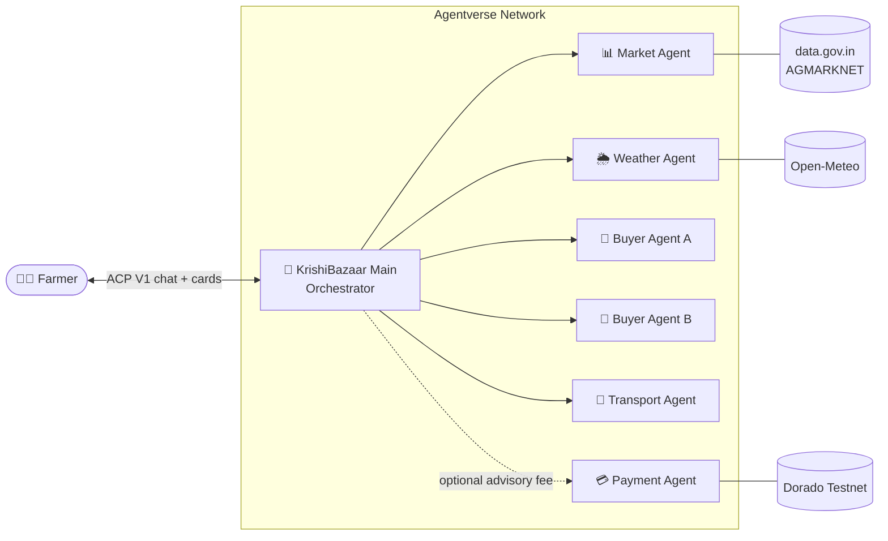
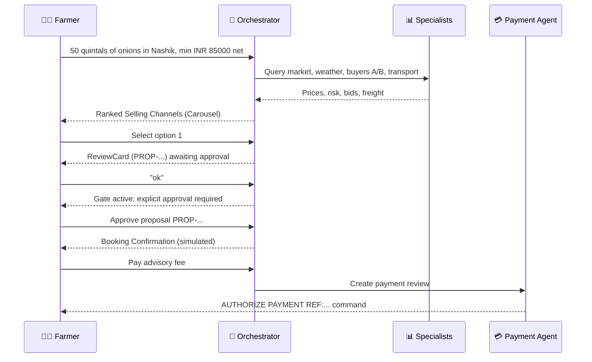

<div align="center">

# 🌾 KrishiBazaar (कृषिबाज़ार)

### Autonomous Farm-to-Market Negotiation Agent Network for Indian Farmers

*Know your true in-pocket return before you sell a single quintal.*


**Built natively for [Fetch.ai](https://fetch.ai) ASI:One** using **uAgents**, the **Agent Chat Protocol (ACP)**, and the official **ASI:One Interactive Card Protocol**.

[Overview](#-overview) · [Architecture](#-architecture) · [Agents](#-agentverse-agents) · [Quick Start](#-quick-start) · [Demo](#-demo-walkthrough) · [Safety](#-data-provenance--safety-model) · [Troubleshooting](#-troubleshooting)

</div>

---

## 📖 Overview

Indian farmers frequently lose **15% to 35%** of their produce value to information asymmetry, opaque mandi commission rates, weather-induced transit spoilage, and unexpected logistics deductions.

**KrishiBazaar** deploys a collaborative network of specialized uAgents that negotiate on the farmer's behalf and compute the true **net financial return**:

$$\text{Net Return} = (\text{Quantity} \times \text{Offered Price}) - (\text{Freight} + \text{APMC Cess} + \text{Hamali/Labor} + \text{Storage} + \text{Weather Risk Buffer})$$

> [!IMPORTANT]
> All financial calculations are **strictly deterministic Python arithmetic**. There is zero LLM math, so no financial hallucinations and no guesswork.

### ✨ Highlights

| | Feature | What it does |
| :-: | :--- | :--- |
| 📊 | **Live mandi prices** | Official AGMARKNET daily wholesale modal prices from data.gov.in |
| 🌦️ | **Transit weather risk** | Live Open-Meteo forecasts mapped to spoilage hazard ratings |
| 🤝 | **Multi-buyer negotiation** | Two independent buyer agents bid, and the orchestrator ranks the options |
| 🚚 | **Freight modelling** | Vehicle matching by quantity, distance routing, rain-cover surcharges |
| 🃏 | **Interactive cards** | Carousel, Review, Confirmation and Payment cards inside ASI:One |
| 🔐 | **Human approval gates** | Casual replies like "ok" never confirm a booking or a payment |
| ⛓️ | **On-chain verification** | Advisory-fee settlement verified on the Fetch.ai Dorado testnet |

---

## 🏗️ Architecture



**Flow:** the farmer describes their produce in natural language → the orchestrator extracts structured parameters → specialists are queried in parallel → net return is computed deterministically per channel → ranked options are shown as interactive cards → nothing is booked until the farmer gives explicit approval.

---

## 🤖 Agentverse Agents

The network is registered and discoverable on Agentverse. Farmers talk to the main entry point through **ASI:One** or **Agentverse Chat**; the orchestrator coordinates the specialists autonomously.

| Agent | Agentverse Address / Handle |
| :--- | :--- |
| 🧠 **KrishiBazaar Main** | `@krishibazaar-india` |
| 📊 **krishibazaar_market** | `agent1q0rsn3us4d9twt209r2xefsqku4qvgypjtp8xvkjep4tmrvrsldnw4z5az4` |
| 🌦️ **krishibazaar_weather** | `agent1qwzwhwgk3hft3z9qnaf2y7mdlwll2r23383fn6x0fhmj33lyuwuhqhq49rv` |
| 💼 **krishibazaar_buyer** | `agent1qtgmthsczmt5uxchs9pz0033vrfm4mwhwl5lhqewz80qfggkjay659sn3fu` |
| 🚚 **krishibazaar_transport** | `agent1q0he7rn2yyh7lkswt37hdddfaf7vjcu4vtvyjd2npte07vw6dnygk7tjl8j` |
| 🏢 **krishibazaar_buyer_b** | `agent1qgw98k45pq6xp6vtj6sy4mrdmhjn206zaqs5f7ff6ghsj5rafs39sesvpzh` |
| 💳 **krishibazaar_payment_agent** | `agent1qfw20k2rw8p68e04mzzul2sedcjgcfcryz29hh55xf3d9vz7f59tstejszf` |

### Roles & Responsibilities

<details>
<summary><b>🧠 KrishiBazaar Main</b> — farmer-facing orchestrator</summary>

<br>

The primary project entry point. Handles natural-language farmer dialogue via Agent Chat Protocol (ACP V1) / ASI:One chat and:

- extracts structured inquiry parameters (crop, quantity in quintals, origin, deadline, minimum net return target)
- coordinates specialist queries
- runs deterministic multi-channel net-return optimization
- renders interactive UI cards (Carousel, Review, Confirmation, Payment Review)
- enforces the mandatory explicit farmer approval gate

</details>

<details>
<summary><b>📊 krishibazaar_market</b> — official mandi prices</summary>

<br>

Queries the official Indian Open Government Data ([data.gov.in](https://data.gov.in) / AGMARKNET) daily mandi price dataset for target commodities and districts. It validates prices against clerical errors and unit mismatches (e.g. per-kg or per-bundle anomalies), reports transparent data provenance, and provides regional/state benchmarks when local district arrival records are unavailable.

</details>

<details>
<summary><b>🌦️ krishibazaar_weather</b> — transit spoilage risk</summary>

<br>

Evaluates live forecasts (precipitation probability, rain volume, temperature extremes) along transit routes via the Open-Meteo REST API. Produces objective spoilage hazard ratings (`LOW`, `MEDIUM`, `HIGH`) and transit risk deductions.

</details>

<details>
<summary><b>💼 krishibazaar_buyer</b> — Buyer Specialist A</summary>

<br>

Generates structured, simulated benchmark procurement bids from regional aggregators, Farmer Producer Organizations (FPOs), and organized retail hubs for negotiation modelling.

</details>

<details>
<summary><b>🏢 krishibazaar_buyer_b</b> — Buyer Specialist B</summary>

<br>

Generates alternative simulated benchmark offers from institutional buyers, corporate agribusinesses, and export commodity aggregators.

</details>

<details>
<summary><b>🚚 krishibazaar_transport</b> — freight & logistics</summary>

<br>

Estimates freight quotes, calculates distance between farmgate and destination, matches vehicle capacity (Tata Ace, 407, 17ft, 22ft container), and includes weather protection surcharges (e.g. tarpaulin coverage).

</details>

<details>
<summary><b>💳 krishibazaar_payment_agent</b> — advisory-fee settlement</summary>

<br>

Implements the official Fetch.ai Agent Payment Protocol (`payment_protocol_spec`) in the seller/payee role. It handles advisory-fee payment reviews, enforces an explicit human authorization gate (`AUTHORIZE PAYMENT REF:...`), validates recipient, currency and amounts, and performs authoritative on-chain settlement verification on the Fetch.ai Dorado Testnet.

</details>

---

## 🔌 Local Development Ports

For local development, unit testing and multi-process debugging, agents bind to loopback ports on `127.0.0.1`:

| Local Agent Process | Port | Protocol / Spec | Internal Data Source |
| :--- | :---: | :--- | :--- |
| **Orchestrator** | `8000` | `AgentChatProtocol` (ACP V1) | ASI:One API (`asi1-mini`) + SQLite |
| **Market Agent** | `8001` | `KrishiBazaarMarketProtocol` | [data.gov.in](https://data.gov.in) (AGMARKNET API) |
| **Weather Agent** | `8002` | `KrishiBazaarWeatherProtocol` | [Open-Meteo REST API](https://open-meteo.com) |
| **Buyer Agent A** | `8003` | `KrishiBazaarBuyerProtocol` | Simulated institutional benchmarks |
| **Transport Agent** | `8004` | `KrishiBazaarTransportProtocol` | Simulated fleet logistics models |
| **Buyer Agent B** | `8005` | `KrishiBazaarBuyerBProtocol` | Simulated corporate benchmarks |
| **Payment Agent** | `8006` | `payment_protocol_spec` (seller/payee) | Fetch.ai Dorado Testnet (`dorado-1`) |

> [!NOTE]
> Ports `8000`–`8006` are strictly for local loopback testing and are **not public endpoints**. In deployed mode, agents communicate through Agentverse mailboxes and decentralized uAgents protocols.

---

## 🚀 Quick Start

### Prerequisites

- **Python 3.13** or **3.14**
- **Git**
- Windows PowerShell (commands below are PowerShell-specific)

### 1. Clone

```powershell
git clone https://github.com/your-org/KrishiBazaar.git
cd KrishiBazaar
```

### 2. Create and activate a virtual environment

```powershell
py -3.13 -m venv .venv313
.\.venv313\Scripts\Activate.ps1
```

### 3. Install dependencies

```powershell
python -m pip install --upgrade pip
pip install -r requirements.txt
pip install -e .
```

### 4. Configure environment

```powershell
Copy-Item .env.example .env
```

Open `.env` and review the settings. Safe local defaults and deterministic seeds are provided.

> [!WARNING]
> Never commit private keys, wallet seed phrases, API keys, or any secret credentials to version control.

### 5. Start the agents

Launch the specialists first, then the Payment agent, then the Orchestrator. Use **seven separate PowerShell tabs**:

| Tab | Agent | Port | Command |
| :-: | :--- | :-: | :--- |
| 1 | Market | `8001` | `python .\src\krishibazaar\agents\market_agent.py` |
| 2 | Weather | `8002` | `python .\src\krishibazaar\agents\weather_agent.py` |
| 3 | Buyer A | `8003` | `python .\src\krishibazaar\agents\buyer_agent.py` |
| 4 | Transport | `8004` | `python .\src\krishibazaar\agents\transport_agent.py` |
| 5 | Buyer B | `8005` | `python .\src\krishibazaar\agents\buyer_b_agent.py` |
| 6 | Payment | `8006` | `python .\src\krishibazaar\agents\payment_agent.py` |
| 7 | **Orchestrator** | `8000` | `python .\src\krishibazaar\agents\orchestrator.py` |

In every tab, activate the environment first:

```powershell
.\.venv313\Scripts\Activate.ps1
```

Each agent prints a startup banner with its local endpoint, address, and protocol bindings.

---

## 🎬 Demo Walkthrough

### Smoke test

Verify ports, specialist connections and pipeline math without creating bookings:

```powershell
# Full live test: ports + live specialist queries + pipeline math
.\.venv313\Scripts\python.exe smoke_test.py

# Quick socket check only (ports 8000-8006)
.\.venv313\Scripts\python.exe smoke_test.py --ports-only

# In-memory pipeline check, no background agents required
.\.venv313\Scripts\python.exe smoke_test.py --offline
```

### Interactive dialogue



<details open>
<summary><b>Step-by-step</b></summary>

<br>

**1️⃣ Farmer submits a produce inquiry**

> *"I have 50 quintals of onions in Nashik, and I want at least INR 85000 net by tomorrow."*

The orchestrator queries Market, Weather, Buyer A, Buyer B and Transport over HTTP, then renders a **Ranked Selling Channels CarouselCard** with provenance and itemized deductions.

**2️⃣ Farmer selects an option**

> *"Select option 1"* (or click the **Select Rank #1** CTA)

A **ReviewCard** is generated with a Proposal Reference (e.g. `PROP-20261021-XXXXXX`), itemizing Freight, APMC Cess, Hamali/Labor, Weather Risk Loss and Net Return. Status: `AWAITING EXPLICIT FARMER APPROVAL` (valid for 15 minutes).

**3️⃣ Casual acknowledgment does NOT confirm**

> *"ok"* or *"sounds good"*

The safety gate activates. The orchestrator explains that explicit approval is required and redisplays the existing proposal, without creating a booking or re-asking for crop details.

**4️⃣ Explicit approval confirms a simulated booking**

> *"Approve proposal PROP-20261021-XXXXXX"* (or click **Approve & Generate Booking**)

The proposal ID and expiry are validated, a confirmation audit record is written atomically to SQLite (`krishibazaar.db`), and a **Booking Confirmation Card** is shown (`is_simulated_booking=True`). Duplicate approvals are blocked.

**5️⃣ Optional advisory-fee payment**

> *"Pay advisory fee"* (or click **Proceed to Payment Review**)

A **Payment Review DetailCard** is generated for 0.05 FET on Dorado testnet, with an exact command template:

```text
AUTHORIZE PAYMENT REF:KB-PAY-... AMOUNT:50000000000000000 CURRENCY:atestfet RECIPIENT:fetch1n09y85ndck56dmxrud7xpkmal0qqtqsej36u0h
```

The human gate executes the broadcast, validates the Dorado ledger block height, verifies transferred funds, and records settlement with the actual gas fee.

</details>

---

## 🛡️ Data Provenance & Safety Model

KrishiBazaar strictly separates verified real-world data from simulations, regulatory assumptions and testnet payments.

| Category | Status | Details |
| :--- | :-: | :--- |
| **Mandi prices** (`data.gov.in`) | ✅ Real | Official AGMARKNET daily wholesale modal prices. Never fabricated. With zero district arrivals, regional state-level benchmarks are shown with an explicit provenance notice and never passed off as local quotes. |
| **Transit weather** (`Open-Meteo`) | ✅ Real | Live forecasts mapped to the transit date, with `LOW` / `MEDIUM` / `HIGH` spoilage ratings. |
| **Buyer bids** | 🧪 Simulated | Benchmark models for negotiation comparison (`is_simulated=True`). No real buyer bid or trade contract exists without verified offline execution. |
| **Freight logistics** | 🧪 Simulated | Vehicle sizing by quantity (e.g. 50 quintals → Tata 407), dynamic distance routing, rain-cover surcharge. |
| **APMC cess (1.5%) & hamali (INR 25/qtl)** | ⚠️ Assumed | Unverified assumptions. Direct buyer trades assume an APMC exemption outside market yards; this is disclosed and **not** legally confirmed advice. |
| **Bookings** | 🧪 Simulated | Marked `is_simulated_booking=True`. No physical sale, contract or carrier dispatch occurs. |
| **Advisory-fee payment** | 🧪 Testnet | 0.05 FET on Dorado (`dorado-1`) using `atestfet`. A service-fee demo, completely separate from any fiat crop proceeds. |

### 🔐 Human approval gates

1. **Booking gate:** casual affirmations (`"ok"`, `"sounds good"`) are blocked. Explicit confirmation (`"Confirm booking"`, `"Approve proposal PROP-..."`) is mandatory.
2. **Payment gate:** the exact structured authorization (`AUTHORIZE PAYMENT REF:... AMOUNT:... CURRENCY:... RECIPIENT:...`) is mandatory before any transaction is broadcast.

### 🔑 Credential security

Configure secrets locally via `.env` (use `.env.example` as the template). Never commit private keys, seed phrases, API keys or other credentials.

---

## 🧪 Testing

```powershell
# Run all 403 regression and integration tests
.\.venv313\Scripts\python.exe -m pytest -v
```

| Test area | Coverage |
| :--- | :--- |
| **Financial arithmetic** | Gross value, itemized deductions, net return, per-quintal rates, target threshold consistency |
| **Provenance & disclosures** | APMC/hamali unverified-assumption notices, zero-record notices, regional benchmark distinction |
| **Card protocol** | Carousel, Detail, Review and Form card generation with CTA payload validation |
| **Approval safety gates** | Casual-ack blocking, ID mismatch rejection, expiry enforcement, cancellation, duplicate prevention |
| **Multi-process HTTP integration** | Live request/response validation across specialists on ports 8001–8006 |
| **Payment invariants** | Address preflight, recipient whitelisting, exact base units, gas preflight, uncertain-settlement holding state |

---

## 🩺 Troubleshooting

| Observed output | Cause | Recommended action |
| :--- | :--- | :--- |
| `ERROR: Failed to retrieve messages: 401` | Background Agentverse mailbox token needs refresh. | **No action needed for local demos.** Direct inter-agent HTTP messaging runs independently on ports 8000–8006. |
| `WARNING: I do not have enough funds to register on Almanac contract` | Agent has no mainnet FET for contract registration. | **No action needed.** Almanac REST registration succeeds automatically; contract writes are optional. |
| `UnicodeEncodeError: 'charmap' codec can't encode characters` | PowerShell console defaults to CP1252. | Run `chcp 65001`, or set `$OutputEncoding = [Console]::OutputEncoding = New-Object System.Text.UTF8Encoding` first. |
| `Port already in use` (8000–8006) | Another process is bound to the port. | Find it with the command below, then `Stop-Process -Id <PID>`. |
| `specialist query timed out` | Upstream latency on data.gov.in. | The orchestrator falls back to verified regional benchmarks and shows a provenance disclaimer. |

```powershell
Get-NetTCPConnection -State Listen | Where-Object { $_.LocalPort -ge 8000 -and $_.LocalPort -le 8006 }
```

---

## ✅ Hackathon Compliance Checklist

- [x] **No LLM math:** all returns and deductions come from deterministic Python business logic
- [x] **Full provenance transparency:** simulated bids, freight quotes and statutory assumptions are labelled
- [x] **Strict safety gates:** no real crop sale, buyer contract or carrier dispatch is ever initiated
- [x] **Credential protection:** no private seeds, tokens or secrets in source, logs or docs
- [x] **Testnet fee isolation:** advisory payment runs on Dorado only, with explicit authorization, fully isolated from crop proceeds

---

<div align="center">

**Built with ❤️ for Indian farmers on the Fetch.ai ecosystem**

🌾 *Fair price. Full transparency. Farmer in control.* 🌾

</div>
